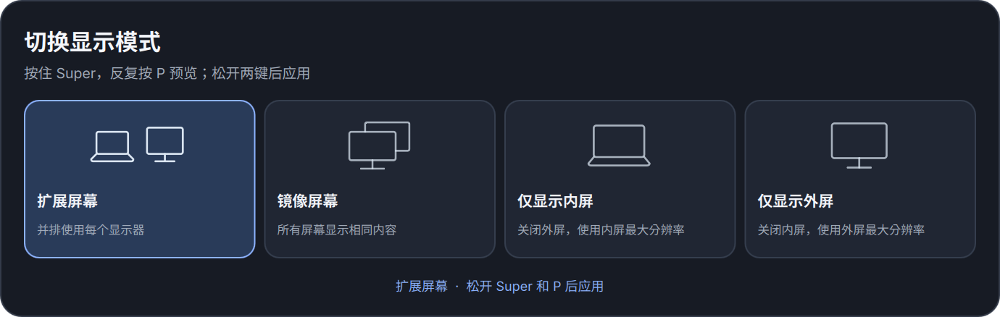

# Switch Display

[English](README.md) · [GPL-3.0](LICENSE)

独立的 Omarchy Shell 显示布局选择器。按住 **Super** 并按 **P** 后会显示一行四种布局预览；保持 Super 按住，再按 P 可循环预览。只有 Super 和 P 都松开后，插件才应用选中的布局并关闭预览。

Super+P 完整循环扩展、镜像、仅内屏、仅外屏；手动切换只影响当前会话，不会写回启动配置。开发机器的启动布局设为双屏扩展，插件不会替其他机器修改启动布局。



插件不调用、不导入，也不依赖 Better Displays Pro。布局由插件直接读取 Hyprland 的显示器信息，并通过 Hyprland Lua monitor API 应用。

## 安装

需要支持插件系统的 Omarchy Shell、Quickshell 全局快捷键、Hyprland Lua monitor API 与 `hl.is_key_down`、Python 3，以及支持曲线渲染器的 Qt Quick VectorImage。已在 Omarchy 4.0.4、Hyprland 0.56.2 和 Qt 6.11.2 上验证。如安装了 hyprmoncfg，应使用手动管理模式。

```bash
git clone https://github.com/manateelazycat/omarchy-switch-display.git
cd omarchy-switch-display
./install.sh
```

安装脚本会将项目链接到 `~/.config/omarchy/plugins/andy.switch-display` 并启用插件，备份快捷键配置后将 Super+P 改为布局预览。安装后请保留项目目录。

更新已有安装：

```bash
git pull --ff-only
./install.sh
```

可用 `omarchy-shell andy.switch-display status` 查看当前选择、应用状态和错误信息。该服务不使用 `keepLoaded`，以便重扫插件时重新加载修改后的 QML。

## 切换行为

应用布局前，选择器先关闭并释放键盘焦点。程序确认选择器的图层已消失后，在不与现有布局重叠的位置启用目标屏幕、解除不需要的镜像，并等待实际显示器状态连续两次符合配置。关闭其他屏幕后，再将目标屏幕移到最终位置。已经符合目标布局的屏幕不重复改写。

如果目标屏幕未就绪，程序停止关闭操作并尝试恢复原布局。遇到显示器拔出时，会尝试恢复仍连接的可用屏幕。并发切换会被拒绝；`hyprmoncfgd` 处于自动管理模式时，也会在修改布局前拒绝操作。

## 崩溃修复（1.1.1）

2026-10-12 11:14:49 的日志记录了 `eDP-1` 被移除、`FALLBACK` 输出被创建，随后 Hyprland 0.56.2 崩溃。崩溃报告与 core 的调用栈均指向 `CLayerSurface::onDestroy → onUnmap → CInputManager::refocusLastWindow`。Hyprland 捕获 SIGSEGV 后调用 abort，因此 systemd-coredump 记录的是 SIGABRT。该时段没有发现 OOM 或内核 GPU 崩溃记录。

旧代码按显示器枚举顺序在一次 Lua 调用中提交布局；内屏排在外屏前时，会先关闭仍被外屏镜像的内屏。结合上述日志，最可能的触发路径是镜像源先被关闭，导致暂时没有独立输出，而仍占用焦点的界面层在显示器移除过程中销毁。修复将启用、状态确认和关闭拆成独立阶段，并在切换前收起选择器，以避开这条路径。

同时修正 Lua 错误处理、镜像来源验证和命令超时；镜像解除后，仅当外屏支持当前分辨率时才复用该分辨率，避免不必要地从 1080p 切到 4K。

## 重叠提示与插拔回退修复（1.1.2）

Hyprland 会在布局变化后检查独立输出是否重叠，并显示“你的显示器没有正确设置”的提示（[该版本的检查实现](https://github.com/hyprwm/Hyprland/blob/v0.56.2/src/state/MonitorLayoutController.cpp#L36)）。此前启用目标输出时就设置 `0x0`，旧输出尚未关闭，因此中间状态会重叠。现在先在现有布局和最终布局右侧安排临时位置，再完成关闭和归位。

回退时会同时处理快照之后新接入的显示器，避免因多出一个输出而中断恢复、将内屏留在临时坐标。新接入的独立输出会放在恢复后的屏幕旁边；符合目标布局的输出不重复移动或重设模式。

2026-10-12 的验证包含全部 16 种布局切换组合的真机后端测试，以及最新代码的真实选择器“镜像 → 扩展 → 镜像”验证，未产生新的重叠日志。24 个回归测试检查了中间阶段、不同缩放和旋转、热插拔回退以及重复选择不改写输出。期间外屏在快照之后重新接入，暴露出旧回退逻辑遗漏新输出的问题；现场已恢复双屏 1080p 镜像并重启 Omarchy Shell，用户确认闪烁停止。

## 单屏分辨率与预览图标（1.1.3）

预览中的内屏使用笔记本图标，外屏使用带支架的显示器图标；扩展和镜像模式同时显示这两种设备。切换到仅内屏或仅外屏时，启用的屏幕使用其支持的最大像素面积分辨率，并在该分辨率下选择最高刷新率，不再沿用镜像时的较低分辨率。多个外屏分别选择各自的最大分辨率，保留原有缩放和旋转；无法读取有效模式时交给 Hyprland 使用 `preferred`。

扩展和镜像模式继续沿用现有的分辨率策略。失败回退仍恢复切换前的分辨率。

## 登录崩溃防护（1.1.4）

2026-10-12 12:50、12:53、12:58 的三份崩溃报告均记录了 `HDMI-A-1 disconnected`，随后在 `IHyprRenderer::damageMirrorsWith` 中触发 SIGSEGV。12:58 的 core 中，该函数的故障指令读取地址 `0x60`，确认发生了空指针访问。[Hyprland v0.56.2 的对应源码](https://github.com/hyprwm/Hyprland/blob/v0.56.2/src/render/Renderer.cpp#L2820)在检查镜像弱引用有效性之前访问了镜像显示器字段，与上述故障吻合。

当前插件在加载时不会应用显示布局。登录时的镜像规则来自 `~/.config/hypr/hyprmoncfg-monitors.lua`，该文件即使在 hyprmoncfg 为手动管理模式时仍由 Hyprland 加载。因此，只修改插件的切换顺序不能解决登录时的这条崩溃路径。

本机已将上述启动布局改为双屏扩展，保留原有 1080p 模式、缩放和工作区绑定。修改前的配置和插件源码备份在 `~/.local/state/omarchy-switch-display/crash-fix-20261012-130251/`。保存的 `mirror-1080p` 配置仍然保留，hyprmoncfg 保持手动管理。

1.1.4 曾通过版本检查禁用镜像选项，并将失败恢复中的镜像转换成扩展。这项限制在 1.1.5 中已移除，启动布局仍保留为扩展。

1.1.4 验证时，35 项回归测试通过；插件校验与 QML 解析通过；真实镜像请求被拒绝且显示器状态未变；真实全局快捷键成功打开选择器并完成扩展布局应用，Hyprland PID 保持 5566。启动配置已在当前桌面加载为双屏扩展，配置错误为空，修复后未发现新 core。完整退出再登录尚未实测。

## 恢复手动镜像（1.1.5）

Super+P 恢复完整的四种模式循环，镜像卡片恢复正常显示，前端和后端均不再按版本禁用镜像。失败时仍按阶段恢复原布局，包括手动选择的镜像布局；并发、自动管理冲突、选择器关闭确认和目标输出就绪检查继续保留。

插件加载时不运行布局程序。每次手动切换仅通过 `hyprctl eval` 修改当前会话，不保存布局，也不修改 `hyprmoncfg-monitors.lua`、`monitors.lua` 或已保存的显示器配置。本机启动时继续加载扩展布局，因此在当前会话手动使用镜像不会把镜像带到下次登录。`--capabilities` 保留兼容入口，返回 `mirrorAllowed: true`，无需查询 Hyprland 版本。

新增回归测试验证所有手动模式都不改写启动配置，以及加载后端没有布局操作。启动路径已避开已确认的镜像故障；Hyprland 0.56.2 的镜像热插拔缺陷本身仍存在，手动镜像期间外屏断开仍可能触发它。

1.1.5 验证：31 项回归测试、插件校验、QML 解析均通过。连续触发两次真实全局快捷键回调，选择器成功选中并应用镜像，状态为 `mirrorAllowed: true`。对比实际启动文件和显示器配置文件，其内容及修改时间均未变化。随后直接加载保存的启动显示配置，正常恢复双屏 1080p 扩展，Hyprland PID 始终为 5566，未出现新 core。此次未退出会话或重新登录。

## 精细矢量图标（1.1.6）

预览图标重新绘制为细描边的矢量设备图形，统一圆角、线宽和视觉比例。笔记本增加底座、凹槽和边缘高光，外接显示器使用收窄支架与薄底座；屏幕采用淡蓝渐变和曲线画面。扩展模式使用不同画面与双向箭头，镜像模式使用相同画面与等号；单屏图标适当放大。选中时图标同步高亮，在不同桌面缩放下保持清晰。

## 简洁 SVG 线条图标（1.1.7）

四种模式使用独立的 SVG 线条图标，统一单色、线宽、圆角端点和留白。扩展用并排的笔记本与显示器表示，镜像用重叠的屏幕表示，单屏模式分别使用笔记本与显示器轮廓。图标采用空心描边，去除渐变、阴影、屏幕画面和装饰细节；选中时提高线条亮度。使用 Qt 的 SVG 矢量曲线渲染器适配桌面缩放。

## 验证

```bash
python3 -m unittest discover -s tests -v
omarchy plugin validate .
/usr/lib/qt6/bin/qmlformat --normalize Service.qml >/dev/null
/usr/lib/qt6/bin/qmlformat --normalize DisplayLayoutIcon.qml >/dev/null
```

测试模拟异步显示器状态变化，覆盖镜像切到仅外屏、所有布局切换组合、目标屏幕未就绪或拔出、切换失败恢复、并发切换及自动管理冲突。测试不会改变实际显示布局。

2026-10-12 12:00–12:08 在本机 Hyprland 0.56.2、`eDP-1` 内屏和 `HDMI-A-1` 外屏上完成真机验证：

- 后端依次应用仅外屏、镜像、仅内屏、扩展、镜像，全部成功。
- 通过全局快捷键回调触发真实选择器，连续两次完成镜像到仅外屏切换，均返回“显示布局已切换”。
- 两次 GUI 测试的事件记录均为先 `openlayer`、再 `closelayer`，最后 `monitorremoved eDP-1`。
- 测试后恢复双屏 1920×1080、缩放 1.5 的镜像布局和原工作区。Hyprland PID 始终为 1842。

真机测试还发现原先的 `keepLoaded: true` 会让 Omarchy 重扫后保留旧的 QML 服务实例，已改为 `false` 并重新加载服务。

## 许可证

Copyright (C) 2026 Andy Stewart。

本项目按照 GNU General Public License 第 3 版（仅此版本，`GPL-3.0-only`）发布，完整协议见 [LICENSE](LICENSE)。
