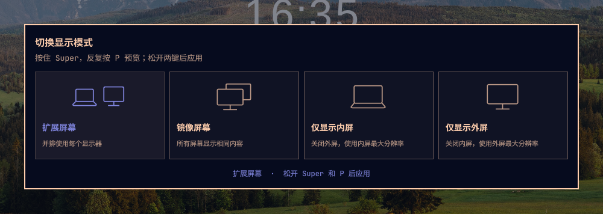

# Omarchy Switch Display



[English](README.md)

简洁的 Omarchy Shell 显示布局选择器。使用 **Super+P**，在扩展、镜像、
仅内屏和仅外屏四种模式之间快速切换。

界面直接使用 Omarchy Shell 的当前主题颜色、字体、间距、边框和系统圆角，切换主题后自动同步。

## 快捷键

| 快捷键 | 操作 |
| --- | --- |
| 按住 `Super` 并按 `P` | 打开布局预览。 |
| 保持 `Super` 按住，再按 `P` | 预览下一种布局。 |
| 松开 `Super` 和 `P` 两键 | 应用选中的布局并关闭预览。 |

## 功能

- 四种显示模式：扩展、镜像、仅内屏和仅外屏。
- 单屏模式使用各屏幕支持的最大分辨率。
- 切换仅影响当前会话，保留已保存的显示器配置与登录布局。
- 简洁的 SVG 线条图标，统一描边，清晰区分各模式。
- 分阶段切换布局，确认目标屏幕就绪，失败时尝试恢复原布局。

## 运行要求

需要支持插件系统的 Omarchy Shell、Quickshell 全局快捷键、Python 3、
Qt Quick VectorImage/Effects，以及 Hyprland Lua monitor API 和 `hl.is_key_down`。

已在 Omarchy 4.0.4、Hyprland 0.56.2 和 Qt 6.11.2 上验证。
如果同时使用 Hyprmoncfg，需要先切换到手动管理模式。

Hyprland 0.56.2 在镜像期间断开外屏时可能崩溃，建议在该版本使用扩展登录布局。
具体排查过程见[更新与排查记录](docs/CHANGELOG.zh-CN.md)。

## 安装

```bash
git clone https://github.com/manateelazycat/omarchy-switch-display.git
cd omarchy-switch-display
./install.sh
omarchy restart shell
```

安装后请保留项目目录：安装脚本会将其链接到
`~/.config/omarchy/plugins/andy.switch-display`，启用插件，
备份 `~/.config/hypr/bindings.lua`，并替换原有的 **Super+P** 快捷键。

安装时会重新加载 Hyprland 保存的显示器配置。
重启 Omarchy Shell 可确保加载最新版插件代码与图标。

## 更新

在已有项目目录中执行：

```bash
git pull --ff-only
./install.sh
omarchy restart shell
```

## 卸载

```bash
omarchy plugin remove andy.switch-display --yes
```

从 `~/.config/hypr/bindings.lua` 删除以
`-- Switch display layouts with the standalone picker.` 开头的配置块，
包括紧接着的 `hl.unbind` 和 `hl.bind` 两行。重新加载 Hyprland，恢复之前的
Super+P 行为：

```bash
hyprctl reload
hyprctl configerrors
```

## 开发

```bash
python3 -m unittest discover -s tests -v
omarchy plugin validate .
/usr/lib/qt6/bin/qmlformat --normalize Service.qml >/dev/null
/usr/lib/qt6/bin/qmlformat --normalize DisplayLayoutIcon.qml >/dev/null
/usr/lib/qt6/bin/qmllint DisplayLayoutIcon.qml
bash -n install.sh
```

以上检查不会改变实际显示布局。查看当前选择、应用状态和错误信息：

```bash
omarchy-shell andy.switch-display status
```

## 许可证

Copyright (C) 2026 Andy Stewart。

GPL-3.0-only，完整协议见 [LICENSE](LICENSE)。
